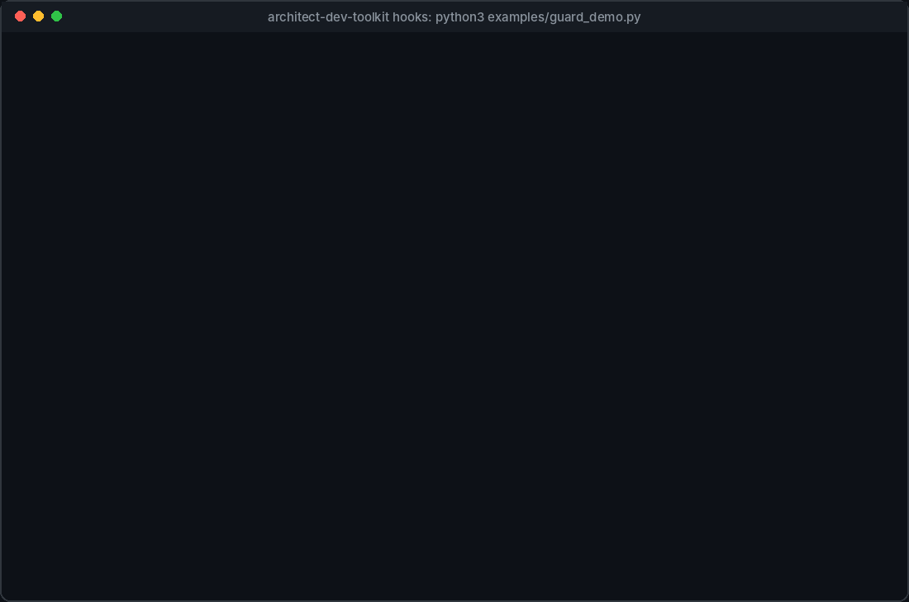

# Architect Dev Toolkit

[](https://github.com/rawnaveen/architect-dev-toolkit/actions/workflows/ci.yml)
[](LICENSE)

A [Claude Code](https://code.claude.com) plugin for engineers and architects who work with
**Java/Spring Boot, AWS/EKS, SRE practices and the Claude API**.



<sub>Real output from the plugin's guard script. Run it yourself: `python3 examples/guard_demo.py`</sub>

It adds **14 skills, 10 subagents and 3 hooks** that work without being called by name:

- **Skills** load when your request matches them ("should we use Kafka or SQS?" writes an ADR).
- **Subagents** are delegated to automatically ("our pod is in CrashLoopBackOff" starts a read-only Kubernetes investigation).
- **Hooks** run on every tool call: they block destructive or production-changing commands and
  token-wasting file reads, and enforce read-only agents.

You can still call anything by name, for example `/architect-dev-toolkit:architecture-decision-record`
or "use the k8s-debugger agent".

## Contents

- [Install](#install)
- [What's inside](#whats-inside)
- [How the automatic behaviour works](#how-the-automatic-behaviour-works)
- [Safety and cost hooks](#safety-and-cost-hooks)
- [Testing and evals](#testing-and-evals)
- [Customising](#customising)
- [Requirements and limitations](#requirements-and-limitations)
- [Contributing](#contributing) · [Security](#security) · [License](#license)

## Install

### Claude Code (recommended)

In a Claude Code session:

```text
/plugin marketplace add rawnaveen/architect-dev-toolkit
/plugin install architect-dev-toolkit@rawnaveen
```

Restart Claude Code (or run `/reload-plugins`). Check that it loaded:

```text
/plugin      # Installed tab lists architect-dev-toolkit
/agents      # lists the 10 agents
/hooks       # lists the PreToolUse and SessionStart hooks
```

Update later with `/plugin marketplace update rawnaveen`.

### Try it for one session without installing

```bash
git clone https://github.com/rawnaveen/architect-dev-toolkit.git
claude --plugin-dir ./architect-dev-toolkit
```

### Claude Desktop / claude.ai

Download the repository as a zip and upload it as a plugin. Only the **skills** work there; subagents
and hooks are Claude Code features.

### Uninstall

```text
/plugin uninstall architect-dev-toolkit@rawnaveen
/plugin marketplace remove rawnaveen
```

## What's inside

### Skills (Claude Code and Claude Desktop)

| Skill | Triggers on |
|---|---|
| `architecture-decision-record` | Technology choices and trade-offs, "write an ADR" |
| `aws-solution-review` | AWS/EKS designs, Terraform/CDK/Helm changes (Well-Architected lens) |
| `incident-postmortem` | Postmortems, RCA, incident reports (blameless template) |
| `observability-instrumentation` | New Spring services, endpoints, consumers; metrics, tracing, SLOs |
| `pr-architecture-review` | "Review my changes / this PR", before merge or push; runs three reviewers in parallel |
| `claude-api-cost-optimizer` | Writing or changing Claude / Amazon Bedrock API calls; "make this cheaper" |
| `claude-integration-reviewer` | Code that calls the Claude API, Agent SDK or MCP; "is this production ready" |
| `tool-schema-designer` | Defining tools / function calling, exposing an API to Claude |
| `mcp-server-scaffold` | "Build an MCP server", wrapping Jira, Confluence, kubectl or a database |
| `prompt-hardening` | Writing or improving prompts and system prompts |
| `llm-eval-harness` | Prompt or model changes, "build an eval", "compare models" |
| `agent-guardrails-config` | Setting up Claude Code in a repo: permissions, hooks, CLAUDE.md |
| `claude-code-cost-coach` | Hitting usage limits, token-heavy sessions, bloated CLAUDE.md |
| `ccdvf-flashcards` | "Quiz me", practice for the Claude Certified Developer: Foundations exam |

### Subagents (Claude Code)

| Agent | Model | Access | Used for |
|---|---|---|---|
| `doc-explorer` | Haiku | Read-only | Wide searches and log reading; returns a summary so the main context stays small |
| `security-reviewer` | Sonnet | Read-only | Security review after sensitive changes and before merge |
| `performance-reviewer` | Sonnet | Read-only | N+1 queries, blocking calls, caching, concurrency |
| `spring-conventions-reviewer` | Sonnet | Read-only | Layering, Spring idioms, transactions, API design, tests |
| `spring-test-writer` | Sonnet | Edit and run tests | JUnit 5, Mockito, slice tests, Testcontainers |
| `k8s-debugger` | Sonnet | Read-only, enforced by hook | Failing pods, rollouts, EKS issues |
| `incident-triage` | Opus | Read-only, enforced by hook | Incidents and alerts; delegates to `k8s-debugger` and `doc-explorer` |
| `dependency-upgrader` | Sonnet | Edit and build | Dependency, CVE and Spring Boot upgrades |
| `runbook-operator` | Inherits | Approval before every change | Following runbooks and tickets |
| `migration-runner` | Opus | Edit and build | Long migrations with `PROGRESS.md` and per-unit commits |

Detailed descriptions: [docs/components.md](docs/components.md).

## How the automatic behaviour works

| Mechanism | What makes it automatic | Reliability |
|---|---|---|
| Skills | Claude matches your request to each skill's `description` and loads its instructions on demand | Usually; depends on phrasing (measured by the trigger evals) |
| Subagents | Claude delegates when a task matches the agent's description (several say "use PROACTIVELY") | Usually; Claude decides |
| Hooks | Claude Code runs them on every matching tool call | Always; deterministic code |

Only the short skill and agent descriptions sit in context each session; full instructions load
when used.

## Safety and cost hooks

All three hooks live in [`hooks/scripts/guard.py`](hooks/scripts/guard.py) (standard library only).
Blocked calls return a reason to Claude, which adapts. If you really meant it, run the command
yourself. Full rules: [docs/hooks.md](docs/hooks.md).

| Hook | Blocks |
|---|---|
| **Bash guard** | `rm -rf` of root, home or the working dir; force push; `git clean -fdx`; destructive SQL; `kubectl delete`; kubectl/helm changes to prod contexts or namespaces; `terraform destroy` and auto-approved applies; mutating AWS CLI calls with a prod profile; shell reads of secret files |
| **Read-only agents** | Any mutation (cluster, cloud, git, files) attempted by `k8s-debugger`, `incident-triage`, the three reviewers and `doc-explorer` |
| **Secret file guard** | Reading or editing `.env*` (except `.env.example`), keys and certificates, `~/.aws/credentials`, `~/.kube/config`, `~/.ssh/`, `.npmrc`, `.git-credentials` and similar |
| **Cost guard** | Reading generated or vendored folders (`target/`, `build/`, `node_modules/`, `dist/`, `.gradle/`...), lockfiles, minified or compiled files, and whole-file reads over 512 KB. Claude is told to grep, read a range, or delegate to `doc-explorer`. Disable per session with `ADT_COST_GUARD=off claude` |
| **Session resume** | Not a block: loads `PROGRESS.md` into context at session start, resume and after compaction, for long-running work |

"Production" means a context, namespace or AWS profile whose name contains `prod`, `prd` or `live`.
Change `PROD_RE` in `guard.py` to match your naming.

### Cost optimisation summary

- **Automatic:** cost guard hook; Haiku `doc-explorer` for searches; Sonnet-pinned reviewers;
  on-demand skill loading; `claude-api-cost-optimizer` when you write Claude API code.
- **One-time per repo:** ask "optimise my Claude setup" to run `claude-code-cost-coach`. It proposes
  CLAUDE.md, rules, MCP and settings changes and applies them only after you confirm. Plugins
  cannot change your settings themselves.

## Testing and evals

| Layer | Command | Cost |
|---|---|---|
| 58 hook regression tests | `python3 tests/test_guard.py` | Free |
| 160 trigger evals (does each skill or agent fire, and stay quiet on near-misses) | `claude plugin eval . --tag trigger --runs 1 --ablation none --max-cost-usd 15` | Model calls |
| 19 output-quality evals on fixture repos with planted problems | `claude plugin eval . --tag output --scaffold --allow-tools Write Edit "Bash(git *)" --max-cost-usd 40` | Model calls and judge calls |

See [evals/README.md](evals/README.md). CI runs the hook tests and `claude plugin validate` on every push.

## Customising

See [docs/customising.md](docs/customising.md). In short:

- Make a skill trigger more or less often by editing the `description` in its `SKILL.md`.
- Change what a skill does by editing its body.
- Tune protected names, secret patterns and size limits at the top of `hooks/scripts/guard.py`, then run `python3 tests/test_guard.py`.
- Remove components you don't use by deleting their folder or file.

## Requirements and limitations

- Claude Code with plugin support. `claude plugin eval` needs v2.1.269 or later.
- `python3` on `PATH` for the hooks (bundled with macOS developer tools and most Linux distributions).
- Hooks use pattern matching, not a sandbox. They prevent common mistakes, not a determined bypass.
  Pair them with least-privilege credentials and Claude Code's sandbox for real isolation.
- Some content is opinionated towards Java/Spring Boot and AWS/EKS.
- Model IDs and prices in the Claude cost skills were checked on 2026-11-08; re-check against the
  [Anthropic docs](https://platform.claude.com/docs) as models change.

## Contributing

Issues and pull requests are welcome. See [CONTRIBUTING.md](CONTRIBUTING.md).

## Security

Please report vulnerabilities privately. See [SECURITY.md](SECURITY.md).

## License

[MIT](LICENSE) © 2026 Naveen Rawat. Not affiliated with or endorsed by Anthropic. "Claude" and
"Claude Code" are trademarks of Anthropic.
